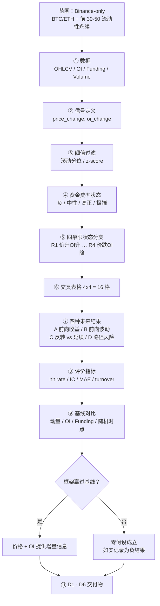
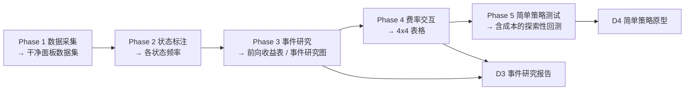

# 导师 Idea Note 流程图导读

> 对象文档：`price_oi_regime_signal_idea_note.docx`（THEO Industrial Project Idea Note —
> *Price + Open Interest Regime Signal*）
> 本文档配合两张流程图使用：
> `research_archive/figures/fig1_research_pipeline.png`（研究逻辑主线）、
> `research_archive/figures/fig2_test_plan_deliverables.png`（执行路线 + 交付物）
> 生成脚本：`research_archive/build_scripts/_build/fig1.py`、`research_archive/build_scripts/_build/fig2.py`、`research_archive/build_scripts/_build/flowlib.py`、`research_archive/build_scripts/_build/fig1_content.py`

---

## 一、这张图要解决的一件事

导师这份 note 是**一条单线逻辑**，从数据一路推到结论，中间没有分叉。所以图 1 的形状是
「一条主干 + 两个并排的检验台」，而不是树状的决策图。

一句话概括导师的方案：

> 用「价格方向 × 未平仓量（OI）方向」把每个时点切成四种状态，看这四种状态**是否**
> 比「只看价格动量」更能预测未来的收益、波动与反转 —— 而且**允许答案是"不能"**。

---

## 二、图 1 逐块读法（研究逻辑主线）

### 第 0 层：范围与口径（最上面两条横条）

| 项 | 内容 | 为什么要先看它 |
|---|---|---|
| 范围 | BTC / ETH 永续 + 流动性前 30–50 的 USDT 永续 | 决定后面所有统计的样本 |
| 剔除 | 稳定币、上市过新、OI 数据不可靠、流动性不足 | 这四条是**数据质量**要求，不是研究假设 |
| 交易所 | 第一版只做 Binance | OKX / Bybit / Hyperliquid 被明确列为 extension |
| 频率 | 1h 为主，4h / 8h 做稳健性，1d 聚合 | 时点全部统一 UTC |

### 第 1 层：①→④ 输入与定义（图 1 第一排）

- **① 数据**：OHLCV、OI、funding、volume、mark/index，liquidation 可选。
  注意 OI 和 funding 在这份方案里的角色**完全不同**：OI 是分类变量，funding 是条件变量。
- **② 信号定义**：`price_change = close_t/close_(t-N) − 1`，
  `oi_change = OI_t/OI_(t-N) − 1`。就两个比值，没有更复杂的东西。
- **③ 阈值过滤**：`|price_change| > price_threshold` 且 `|oi_change| > oi_threshold`。
  起点建议是滚动 60/70 分位或 z-score。**关键约束**：阈值只做稳健性检验，
  不许为了回测好看去调参。
- **④ 资金费率状态**：负（<25 分位）/ 中性（25–75）/ 高正（>75）/ 极端（>90）。
  原文明确写了 funding 是 conditioning variable，不是主信号。

### 第 2 层：⑤⑥ 状态分类与交叉（图 1 第二排）

- **⑤ 四象限**：R1 价↑OI↑（新多进场）、R2 价↑OI↓（空头回补）、
  R3 价↓OI↑（新空进场）、R4 价↓OI↓（平仓/去杠杆）。
  这四个标签是整份方案的**因变量**，后面所有检验都按它分组。
- **⑥ 交叉表格**：状态 × 费率 = 4 × 4 = 16 格，每格算前向收益、前向波动、
  反转/延续概率。这是导师列的 Phase 4 的产出。
  图里也抄了他给的事前预期（延续 / 拥挤反转型风险 / 逼空风险 / 去杠杆后均值回复）——
  这些是**假设**，原文自己强调 "These are hypotheses, not conclusions"。

### 第 3 层：⑦⑧ 检验什么（图 1 第三排）

- **⑦ 四种未来结果**：
  - A 前向收益（1h / 4h / 8h / 24h）
  - B 前向波动
  - C 反转 vs 延续
  - D 路径风险（MFE / MAE / 回撤）
  D 被单独列出来，是因为「平均收益为正但路径很难看」的信号不能算好信号 ——
  这一条对写报告很有用。
- **⑧ 评价指标**：命中率、反转/延续概率、事件后波动、MAE、turnover、
  成本敏感性、IC、分资产/分市场表现。

### 第 4 层：⑨⑩ 判定（图 1 第四排）

- **⑨ 四个基线**：价格动量单独用、OI 变化单独用、资金费率单独用、随机时点。
  **框架必须先打败这四个**。这句话是整个方案的裁判规则。
- **⑩ 结论**：赢过基线 → 有增量；没赢过 → 零假设成立，如实记录为负结果。
  两种结果都可写 —— 这是「先做事件研究、再谈策略」的底气所在。

### 第 5 层：⑪ 交付物

D1 数据管线 → D2 状态分类器 → D3 事件研究报告 → D4 简单策略原型（含成本回测）
→ D5 看板/可视化 → D6 期末报告。D4 被限定为 exploratory backtest，不是生产策略。

---

## 三、图 2 是什么（执行路线）

图 1 是「逻辑」，图 2 是「怎么做」。图 2 的五行就是 note 第 10 节的 Phase 1–5，
每一行左中右三块分别是：**阶段名 / 操作 / 本阶段产出**；左侧竖箭头是阶段依赖，
箭头旁的 D1–D4 表示该阶段对应哪个交付物。

值得记的一点：**Phase 3 和 Phase 4 的产出（前向收益表、4×4 表格）就是 D3**，
**Phase 5 的产出就是 D4**。也就是说交付物不是另起炉灶，而是阶段产出的自然沉淀。

图 2 底部那条红框是我加的唯一一条**外部评论**（不属于导师原文）：
这份方案把成本放在「评价指标里的一行」和 D4 的 costed backtest 里，
而本项目的实测显示成本是时变的（有效价差 2021→2026 压缩约 50 倍），
所以成本精度不宜拖到 Phase 5 才处理。详见第五节。

---

## 四、这份 note 与你自己规划书的关系（读的时候心里有数）

两者**不是替代关系，是互补关系**：

| 维度 | 导师 note | 你的规划书（FTEC5910 Planning Report） |
|---|---|---|
| 主线信号 | 价格 × OI 四状态（事件研究） | 资金费率 carry（Signal A）+ 拥挤反向（Signal B） |
| 成本 | 只在指标里一行 + D4 回测 | RQ1 是成本测量本身的专门研究（Signal S1 / S3） |
| 检验形式 | 事件研究 + 4×4 分组表 + 简单回测 | 三阶段设计 + 机制问题 M1–M3 + 可行性检验 |
| 数据口径 | 1h 起，OHLCV/OI/funding | 逐笔 aggTrades + bookTicker 录制，1m 有效价差 |
| 结论姿态 | 允许「没有增量」 | 同样允许负结果，但成本层的结论是主贡献 |

**我的读法**：导师这份 note 基本相当于你规划书里那块**尚未充分展开的
「价格/OI 状态 × 资金费率」研究** —— 它把你的 funding 条件变量思路，
换成了一个更朴素、更容易讲清楚的 price+OI 框架。所以它有两重用处：

1. 作为**独立方案**：可以直接照着 Phase 1–5 做，产出 D1–D6；
2. 作为**你规划书的补充章节**：你的 RQ2a/RQ2b 讲的是 carry 与拥挤，
   而这份 note 的 4×4 表格恰好能给「拥挤」一个可操作的定义
   （价↓OI↑ + 极端负费率 = 逼空风险）。

---

## 五、如果要动手，注意三个地方（我的提醒，不是导师原文）

1. **成本必须时变**。note 只在指标里写了 transaction cost sensitivity。
   本项目实测：往返约 25 bps（约 90% 是手续费），
   而 1m 有效价差从 2021 的 ~23 bps 压到 2026 的 ~0.1 bps。
   用单一价差假设跑 2019–2026 会得出错误结论（这条已写进你报告 §7.6）。
2. **OI 数据的对齐**。不同交易所的 OI 快照时点、是否含合约切换，
   会让 `OI_t/OI_(t-N)` 在整点附近跳变；note 没有提这件事，
   但 Phase 2 一旦做错，后面全部作废。
3. **整点效应**。1h / 4h / 8h 全是整点，而资金费结算也在整点。
   不控制整点效应，就等于在测错东西（这一点你的 M2 已经处理，
   note 里没有对应内容）。

---

## 六、Mermaid 版（可粘进 Typora / VS Code / mermaid.live 继续改）

> 想要可编辑版本的话，下面两段直接复制即可；PNG 只是渲染结果。

### 图 1 逻辑主线

### 图 2 执行路线

